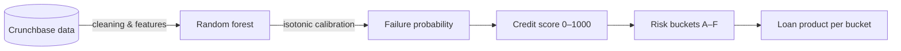
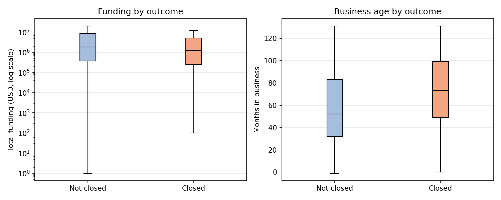
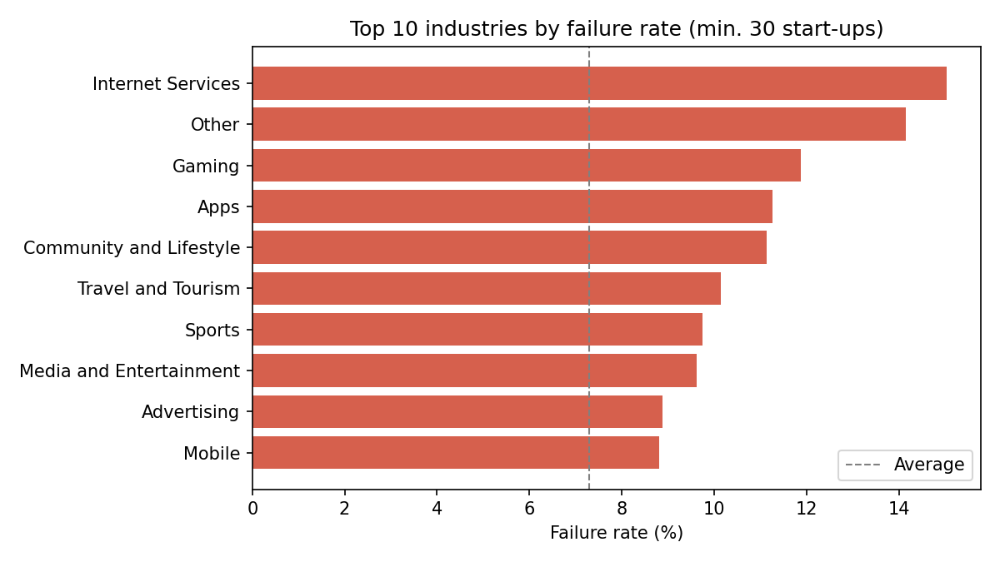
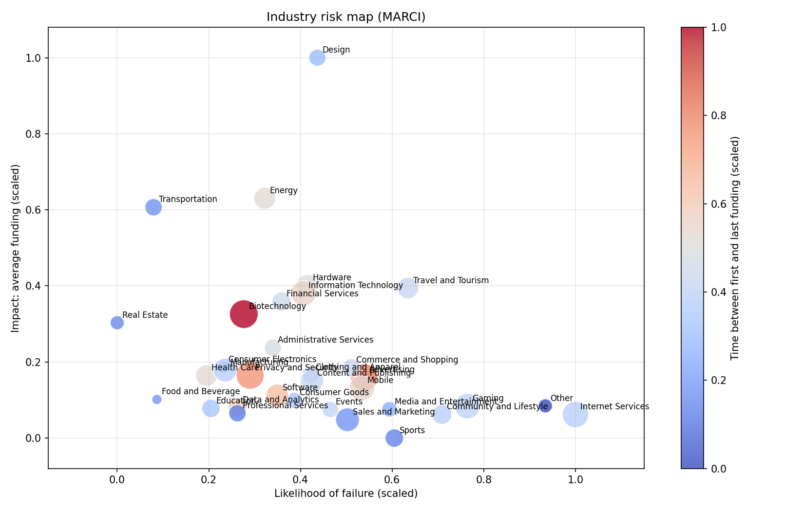
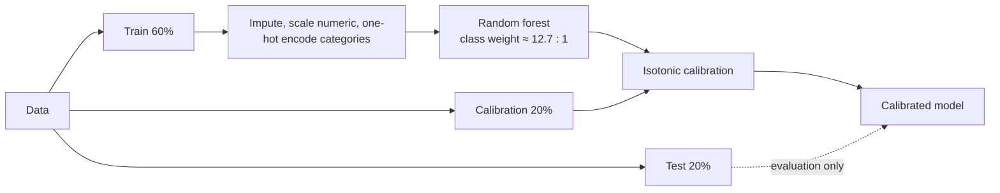
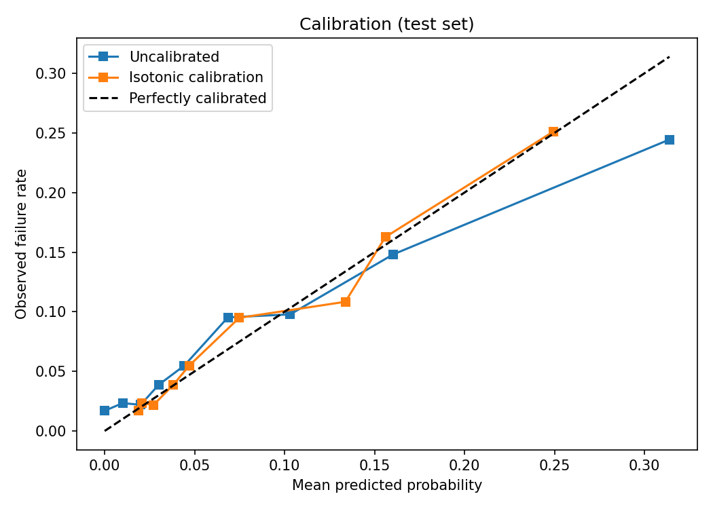
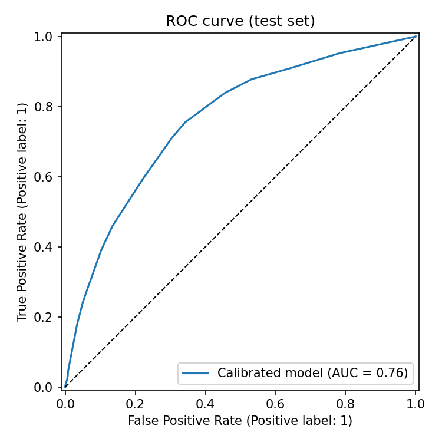
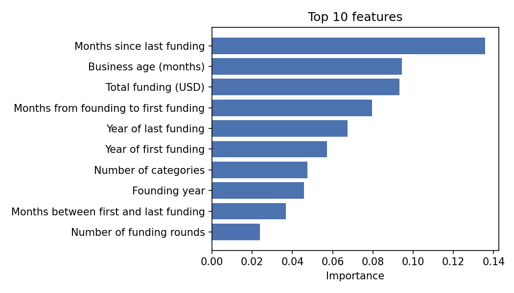
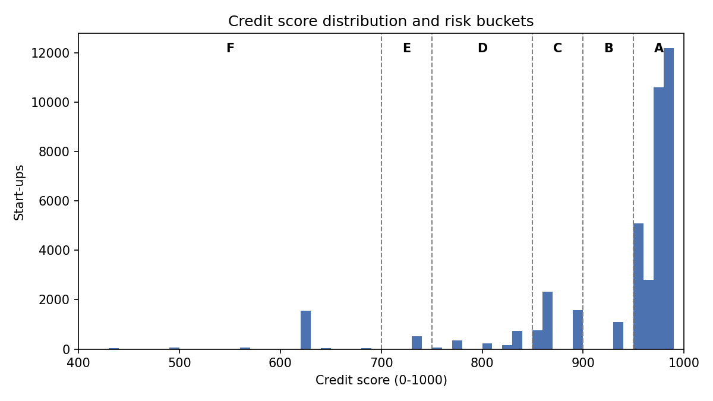
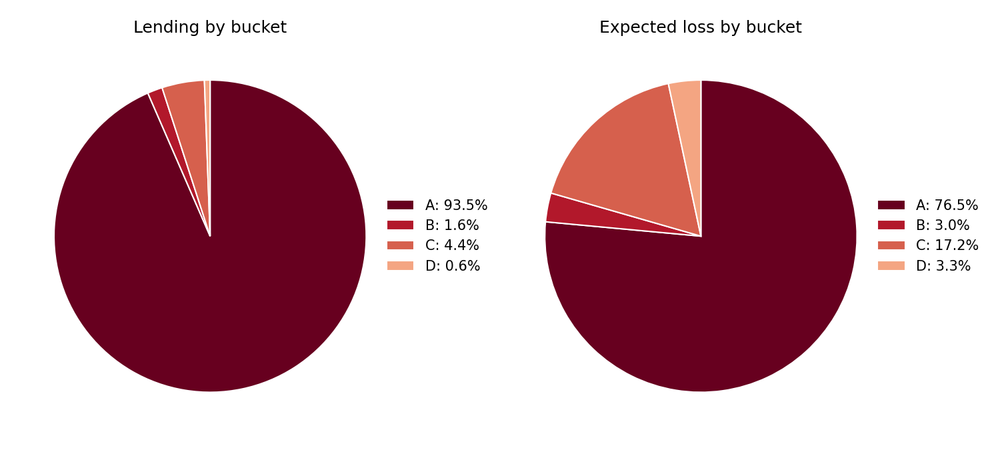

# Start-up Credit Risk Scoring

Can a lender tell, from public funding data alone, which start-ups are likely to fail and what loan each should be offered?

This project builds a **calibrated failure-probability model** for start-ups, turns it into a **0–1000 credit score** with six risk buckets, and designs a **loan product for each bucket**: lending amount, term and risk premium.

It began as a group project for the *Statistical Consulting* course at KU Leuven (2025). This repository is a cleaned-up, reproducible version of the analysis code.



## 1. Data and scope

- **Source:** about 66,000 companies from Crunchbase, last updated in 2015. The data includes founding date, location, funding rounds, funding amounts and business categories.
- **Scope:** start-ups founded in 2005 or later, in countries with more than 1% of the companies (USA, UK, Canada, India, China, Germany, France, Israel and Spain). That leaves **40,473 start-ups**.
- **Default:** a company counts as failed when its status is `closed`. **7.3%** of start-ups in scope are closed.
- **Data enrichment:**
  - Raw Crunchbase categories are grouped into 47 industries, following Crunchbase's own industry list.
  - Missing founding dates are filled with the first funding date.
  - Time-based features are created: business age, months from founding to first funding, months between first and last funding, and months since last funding.

## 2. Exploratory analysis

**Closed start-ups raised less money and were older.** The median closed company raised USD 1.2 million, against 1.8 million for the others. It was also 73 months old, against 52, which suggests many companies kept going for years before closing.



**Failure rates differ a lot by industry.** Internet services fail about twice as often as the average start-up (7.3%). Gaming, apps, and community and lifestyle businesses fail about 1.5 times as often.



**Industry risk map (MARCI chart).** This chart is adapted from the COSO Enterprise Risk Management framework. It places each industry by likelihood of failure (x-axis) and impact, measured as average funding (y-axis).

- **Bubble size** shows business age: smaller bubbles are younger, more fragile industries.
- **Colour** shows the time between first and last funding: blue industries raise their money over a short period, possibly a sign of "fast burn, fast exit".
- **How to read it:** industries further right fail more often, and industries higher up have more money at stake.



## 3. Model



- **Class weights.** There are about 12.7 surviving companies for every failure, so the random forest weights failures more heavily.
- **Calibration.** The forest is trained on the training set. Its probabilities are then calibrated with isotonic regression on a separate calibration set, so a predicted risk of 5% means that about 5% of such companies actually fail.
- **Evaluation.** All results below are measured on the **test set**, which the model never saw during training or calibration.

| Metric (test set) | Uncalibrated | Calibrated | Benchmark |
|---|---|---|---|
| AUC | 0.763 | 0.762 | 0.50 (random guessing) |
| Gini | 0.53 | 0.52 | 0 |
| Brier score | 0.0636 | **0.0627** | 0.0676 (always predict the average) |

**Calibration brings predictions closer to reality.** After calibration (orange), the curve follows the diagonal more closely, especially for the riskiest companies. For pricing loans, this matters more than ranking alone.

<p>
  
  
</p>

**Time since the last funding round is the strongest warning sign,** followed by business age and total funding. A start-up that has not raised money for a long time is the most likely to close.



## 4. Rating scale

Each start-up gets a score of (1 − failure probability) × 1000. The scores are cut into six buckets that mirror the six credit quality steps in **EU Regulation 2016/1799**.



| Bucket | Score | Start-ups (test) | Predicted failure | Observed failure |
|---|---|---|---|---|
| A | 950–1000 | 5,397 | 2.9% | 3.2% |
| B | 900–950 | 258 | 6.1% | 10.1% |
| C | 850–900 | 1,429 | 12.8% | 11.3% |
| D | 750–850 | 681 | 18.8% | 19.8% |
| E | 700–750 | 245 | 26.5% | 29.0% |
| F | 0–700 | 85 | 37.7% | 30.6% |

The observed failure rate rises from A to E and stays close to the prediction in most buckets. Buckets B and F are small, so their observed rates are less certain.

## 5. Loan products

Buckets A–D are offered a loan sized as a share of the company's total funding. The term gets shorter and the risk premium (on top of the risk-free rate) gets higher as risk grows. Buckets E and F are screened out.

| Bucket | Loan (% of funding) | Term | Risk premium | Start-ups | Lending (USD bn) | Expected loss |
|---|---|---|---|---|---|---|
| A | 80% | 3–5 years | +3% | 30,685 | 323.2 | 2.6% |
| B | 60% | 3 years | +8% | 1,104 | 5.4 | 6.1% |
| C | 40% | 2 years | +15% | 4,686 | 15.2 | 12.5% |
| D | 25% | 18–24 months | +20% | 1,547 | 2.0 | 18.3% |
| **Total** | | | | **38,022** | **345.8** | **3.2%** |

**In every bucket, the risk premium covers the expected loss.** Bucket A holds 93% of the lending and 76% of the expected loss.



## Limitations

- The model only uses public funding data, with no financial statements or repayment history.
- "Closed" stands in for an actual loan default.
- The data ends in 2015.
- The project shows the method; it is not a production-ready credit model.

## How to run

```bash
git clone https://github.com/nphanhdung/startup-credit-risk.git
cd startup-credit-risk
pip install -e ".[dev]"

# 1. Download the data (see data/README.md) to data/startup_failures.csv
# 2. Run the full analysis: tables go to outputs/, figures to figures/
python -m startup_credit_risk.pipeline --data data/startup_failures.csv

# Run the tests (use synthetic data, no download needed)
pytest
```

The results above were produced with scikit-learn 1.7.2, pandas 2.3 and matplotlib 3.10. Other library versions can give slightly different numbers.

## Project structure

```
src/startup_credit_risk/
  config.py         all settings: scope, split sizes, bucket ranges, loan terms
  industries.py     Crunchbase category -> industry group mapping
  preprocessing.py  cleaning, date fixes, feature engineering, scope filters
  model.py          train / calibrate / evaluate
  scoring.py        credit score and risk buckets
  products.py       loan products and portfolio view
  plots.py          figures
  pipeline.py       runs everything end to end
figures/            figures shown in this README
notebooks/          walkthrough notebook
tests/              unit and end-to-end tests on synthetic data
```

## Changes from the course version

- **Calibration.** The forest is now trained on the training set and calibrated on a separate calibration set. Before, both steps used only the 20% calibration set.
- **Honest validation.** Bucket failure rates are measured on the untouched test set. The course version reported 83% observed failure in bucket F, but it was measured partly on training data; on new data it is about 31%. The AUC moved from 0.78 to 0.76 for the same reason.
- **Reproducibility.** Time-based features are measured up to the last date in the data, not today's date, so results no longer change from day to day.
- **Missing categories.** Companies with no category are now labelled "Other". Before, they were put in "Administrative Services" by mistake.
- **Charts.** The industry charts leave out industries with very few start-ups, whose failure rates are too noisy to compare.
- **Code structure.** The notebook code was moved into tested modules, with all settings in one config file.

## Data

The raw data is **not included** in this repository. See [data/README.md](data/README.md) for where to get it. It describes companies, not individuals.

## Tools

Python, pandas, scikit-learn, matplotlib, pytest
